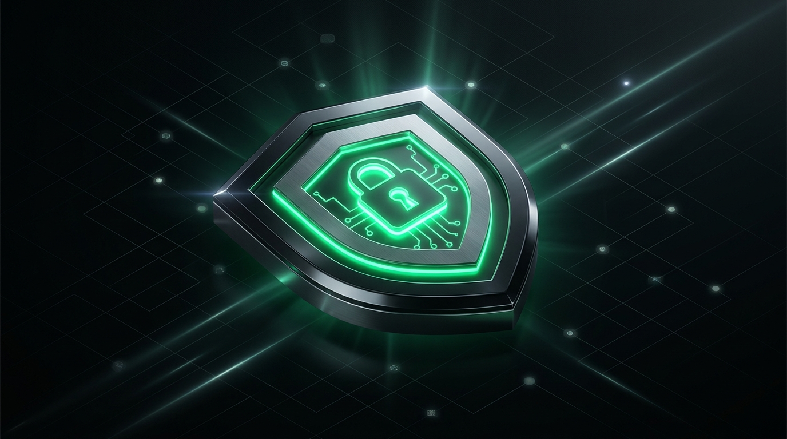

<div align="center">



# 🛡️ Private VPN Monorepo
### Next-Generation Censorship-Resistant VLESS Reality VPN

[](https://flutter.dev)
[](https://github.com/XTLS/Xray-core)
[](https://github.com/XTLS/Xray-core)
[](https://www.docker.com/)
[](https://www.android.com/)
[](https://www.apple.com/ios/)
[](LICENSE)

*A production-ready, open-source monorepo housing both the **Cross-Platform Mobile Client (Flutter Android & iOS)** and the **Automated Cloud Backend (Docker Compose + 3X-UI + Nginx)**.*

[Key Features](#-key-features) • [Architecture](#-architecture) • [Repository Structure](#-repository-structure) • [Server Deployment](#-server-deployment) • [Mobile App Build](#-mobile-app-build) • [Security & Privacy](#-security--privacy-model) • [License](#-license)

</div>

---

## 🌟 Key Features

### 📱 Client (Flutter Android & iOS)
- **VLESS + XTLS-Vision + Reality**: State-of-the-art anti-censorship protocol designed to impersonate legitimate TLS traffic (e.g., Apple, Microsoft, Yahoo) with zero fingerprint for DPI (Deep Packet Inspection) firewalls.
- **Full-Tunnel `tun2socks`**: Intercepts all device IP packets through a high-performance native virtual TUN adapter without DNS leaks.
- **Obsidian Cyberpunk UI**: Designed with sleek deep obsidian dark mode (`#070B09`), cyber neon green accents (`#00FF88`), fluid micro-interactions, and haptic feedback.
- **Live Telemetry & Analytics**: Real-time upload/download speeds, live ping latency testing, session duration timers, and total bandwidth meters.
- **Multi-lingual**: Full out-of-the-box support for **English**, **O'zbekcha (Lotin)**, and **Русский**.
- **Effortless Server Management**:
  - Direct QR Code scanner for 1-tap setup.
  - Clipboard auto-detection for `vless://` URIs.
  - Custom embedded default server support via `assets/config/default_server.json`.
  - Manual server editing and latency checks.

### 🖥️ Backend (Self-Hosted Cloud Server)
- **1-Command Docker Deployment**: Ready-to-use Docker Compose configuration orchestrating the latest `3x-ui` engine.
- **Web Administration Panel**: Intuitive visual panel to manage inbounds, generate client QR codes, monitor per-user traffic quotas, and rotate keys.
- **Automated Update Script**: Single script (`server/update.sh`) to synchronize Git updates, reload Docker, and refresh Nginx reverse proxy certificates.
- **Nginx Reverse Proxy**: Production SSL termination configuration with Let's Encrypt for safe panel administration.

---

## 🏗️ Architecture

```
                  ┌──────────────────────────────────────────────┐
                  │          Private VPN Mobile Client           │
                  │   (Flutter UI + flutter_v2ray / tun2socks)   │
                  └──────────────────────┬───────────────────────┘
                                         │ Encrypted VLESS Reality
                                         │ XTLS-rprx-vision Flow
                                         ▼
                  ┌──────────────────────────────────────────────┐
                  │                 Cloud Server                 │
                  │             (Ubuntu / Debian Linux)          │
                  │                                              │
                  │   ┌──────────────────────────────────────┐   │
                  │   │        Port 8443 (VLESS Reality)     │   │
                  │   │      3X-UI Xray-Core Container       │   │
                  │   │      Impersonates: iCloud / Apple    │   │
                  │   └──────────────────┬───────────────────┘   │
                  │                      │                       │
                  │   ┌──────────────────┴───────────────────┐   │
                  │   │     Port 443 / 2053 (Nginx Web UI)   │   │
                  │   │      SSL Admin Dashboard Panel       │   │
                  │   └──────────────────────────────────────┘   │
                  └──────────────────────┬───────────────────────┘
                                         │ Unrestricted Direct Access
                                         ▼
                              🌐 World Wide Web (Internet)
```

---

## 📂 Repository Structure

This monorepo contains everything required to deploy, build, and maintain the entire private VPN stack:

```
├── android/                     # Android native project & tun2socks JNI libs
├── ios/                         # iOS native project & NetworkExtension runner
├── lib/                         # Flutter client source code
│   ├── l10n/                    # Localization strings (EN, UZ, RU)
│   ├── models/                  # ServerConfig, VpnState data models
│   ├── screens/                 # MainScreen, ServerListScreen, QRScanScreen, Settings
│   ├── services/                # VpnService, StorageService, Localization
│   └── widgets/                 # CyberConnectButton, SpeedGauge, StatusBadge
├── assets/
│   ├── config/
│   │   ├── default_server.json.example   # Safe placeholder template for builds
│   │   └── default_server.json           # Your local private keys (GIT-IGNORED)
│   └── images/
│       └── banner.jpg           # Repository header banner
├── server/                      # Linux backend infrastructure
│   ├── docker-compose.yml       # 3X-UI container definition
│   ├── update.sh                # Automated server pull & reload script
│   ├── README.md                # Server configuration reference
│   └── nginx/
│       └── vpn.example.com.conf # Nginx SSL reverse-proxy template
├── server_setup/
│   └── setup_guide.md           # Step-by-step VPS hardening guide
├── test/                        # Automated unit & widget tests
└── pubspec.yaml                 # Flutter project dependencies
```

---

## 🚀 Server Deployment

Follow these steps to deploy your private VPN server in under 5 minutes on any VPS (Hetzner, DigitalOcean, Contabo, AWS, etc.) running Ubuntu 22.04+ or Debian 12.

### 1. Prerequisites
- A VPS with a public IPv4 address.
- Root or sudo privileges.
- (Optional but recommended) A domain pointing to your server IP (e.g. `vpn.yourdomain.com`).

### 2. Install Docker & Nginx
```bash
# Update packages
apt update && apt upgrade -y

# Install Docker & Docker Compose
curl -fsSL https://get.docker.com -o get-docker.sh && sh get-docker.sh
apt install -y docker-compose-plugin nginx certbot python3-certbot-nginx git ufw

# Configure Firewall
ufw allow 22/tcp     # SSH
ufw allow 80/tcp     # HTTP (Certbot)
ufw allow 443/tcp    # HTTPS (Admin Panel)
ufw allow 8443/tcp   # VLESS Reality Inbound
ufw enable
```

### 3. Deploy 3X-UI Backend
```bash
# Create application directory
mkdir -p /opt/private_vpn && cd /opt/private_vpn
mkdir -p db cert

# Copy docker-compose.yml from this repository
cat << 'EOF' > docker-compose.yml
services:
  3x-ui:
    image: ghcr.io/mhsanaei/3x-ui:latest
    container_name: private_vpn
    restart: unless-stopped
    ports:
      - "127.0.0.1:2053:2053"
      - "8443:8443"
    volumes:
      - ./db/:/etc/xray/
      - ./cert/:/root/cert/
    environment:
      - XRAY_VMESS_AEAD_FORCED=false
EOF

# Start container
docker compose up -d
```

### 4. Setup SSL Reverse Proxy (Nginx)
```bash
# Issue Let's Encrypt Certificate
certbot --nginx -d vpn.yourdomain.com

# Apply the template from server/nginx/vpn.example.com.conf
# Replace vpn.example.com with your actual domain
systemctl reload nginx
```

Now open `https://vpn.yourdomain.com` in your browser, log in to 3X-UI, and create a **VLESS Reality** inbound:
- **Port:** `8443`
- **Protocol:** `VLESS`
- **Security:** `Reality`
- **Target (SNI):** `gateway.icloud.com:443` (or `www.microsoft.com:443`)
- **Flow:** `xtls-rprx-vision`

Copy the generated `vless://` connection URI or scan the QR code!

---

## 📱 Mobile App Build

### Prerequisites
- [Flutter SDK](https://docs.flutter.dev/get-started/install) (3.24.0 or newer)
- Android SDK (API 34+) or Xcode (for iOS builds)

### 1. Clone the Repository
```bash
git clone https://github.com/Kingprogrammer07/private-vpn.git
cd private-vpn
flutter pub get
```

### 2. Configure Default Server (Optional)
If you want the app to be pre-configured with your private server out-of-the-box:
1. Copy the example config:
   ```bash
   cp assets/config/default_server.json.example assets/config/default_server.json
   ```
2. Fill in your server's IP, port, UUID, and public key (`pbk`).
> 💡 *Note: `assets/config/default_server.json` is automatically ignored by Git. Your private credentials will never be committed or leaked.*

### 3. Build Android APK
```bash
# Split per-ABI release build (optimized ~30MB APKs)
flutter build apk --release --split-per-abi

# Generated APKs will be located in:
# build/app/outputs/flutter-apk/app-arm64-v8a-release.apk
```

### 4. Build for iOS
```bash
flutter build ios --release
# Open ios/Runner.xcworkspace in Xcode, select your Development Team, and deploy to your iPhone.
```

---

## 🛡️ Security & Privacy Model

| Traditional VPNs (OpenVPN / WireGuard) | Private VPN (VLESS + XTLS Reality) |
|---|---|
| **Easily Detected:** Uses distinct protocol headers blocked by DPI firewalls. | **Undetectable:** Mimics ordinary HTTPS TLS 1.3 traffic to legitimate domains. |
| **Susceptible to Active Probing:** Firewall probes server port and drops it. | **Active Probing Defense:** Re-routes unauthorized probes to the real target (e.g., Apple). |
| **Centralized Logs:** Commercial providers frequently retain connection records. | **100% Self-Hosted:** You own the VPS and database. Zero third-party telemetry. |

---

## 🧪 Testing

Run automated tests to verify configuration parsers and widget rendering:

```bash
flutter test
```

All 8 core test suites will execute, verifying:
- VLESS Reality URI serialization and deserialization.
- Xray Core client JSON configuration generation.
- Dynamic network speed and bandwidth unit formatters.
- Cyber UI components and status badge transitions.

---

## 📄 License

This project is licensed under the MIT License - see the [LICENSE](LICENSE) file for details.

---

<div align="center">
<b>Built for privacy, freedom, and an open internet.</b>
</div>
